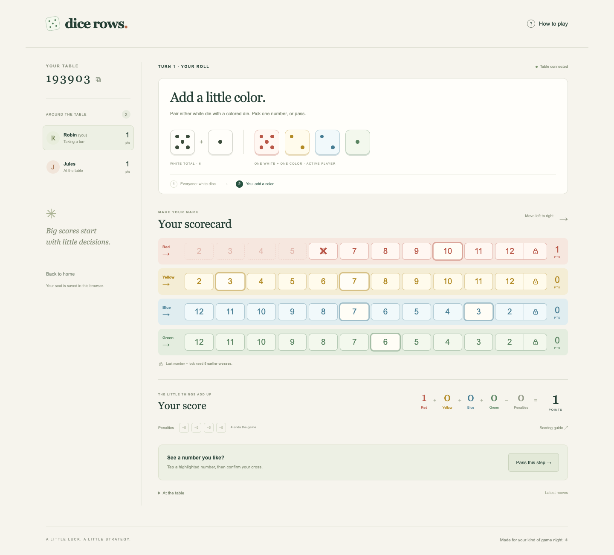

# Dice Rows

A shared dice table for friends playing on their phones. Host a game, share a six-digit code, and make a few small decisions that add up to a big score.



[Phone scorecard](docs/screenshots/mobile-game.png) · [Welcome screen](docs/screenshots/desktop-home.png) · [Rules engine](game.js) · [Tests](test/)

## Play

Requires Node.js 22 or newer. No accounts, API keys, database service, or build step.

```sh
npm ci
npm start
```

Open **http://localhost:3000**. Enter a name, create a table, and share the code. Friends on the same Wi-Fi open `http://YOUR-COMPUTER-LAN-IP:3000` on their own phones. Allow the server through your firewall if needed. The host starts once everyone has joined; starting alone also works for practice.

Remote friends need the same publicly reachable server URL. This PR does not deploy a hosted service. For hosting, run `npm start` behind an HTTPS reverse proxy, set `PORT` if needed, and attach a persistent writable directory using `DATA_DIR` (default `.data/`). Run a **single server process**; the JSON store is not designed for multiple replicas.

## At the table

- **1–8 named players:** a host lobby and a six-digit code for joining before play starts.
- **Shared turns:** everyone chooses the white-dice total or passes before the active player can pair a white die with a colored die.
- **Intentional marks:** tap an available number, then confirm. Cancel changes nothing. Earlier numbers become unavailable as you move right.
- **Locks and endings:** five earlier marks unlock the final number and lock. Locked colors leave the dice tray. Two locked colors or four active-player penalties end the game.
- **Live totals:** each colored row contributes its triangular score, the lock counts as a cross, and each penalty subtracts five. Final scores show the winner, including ties.
- **Phone layout:** the scorecard scrolls horizontally; the rest of the page fits the screen. Refresh restores the current seat in the same browser.

The in-app **How to play** explains the complete rules. White choices resolve as one shared step: a color locked during that step remains available to other players until all white choices are submitted. The active player then completes their optional color choice, and ending conditions resolve at turn completion. Passing the white step does not prevent a color choice. Only the active player takes a penalty, and only if they pass both choices.

## How it works

A dependency-free Node HTTP server serves the client and owns all game state. The pure [rules engine](game.js) validates turn ownership, legal numbers, phase order, locks, penalties and endings. The browser never supplies dice rolls or scores; the server rolls with Node's cryptographic random number generator.

Clients poll authenticated state every 1.2 seconds. Each action includes the state revision: stale moves are rejected and refreshed before a player tries again. This avoids double submissions and conflicting actions without a socket dependency. The tradeoff is a small synchronization delay and a retry when two people submit at the same time.

A random bearer token identifies each seat; it stays in that browser's local storage. Room codes locate tables but do not authorize moves. State and tokens are saved atomically to an ignored JSON file after changes, so seats and games survive server restarts when the data directory persists. Treat that directory as private.

## Verification

```sh
npm run check
npm test
```

Node's test runner covers movement in both directions, all scoring values, the supplied 40-point example, simultaneous white locks, retiring dice, turn permissions, penalties, both endings, HTTP validation, stale actions, reconnect, and restart persistence. GitHub Actions runs the same commands on Node 22.

A two-context Chrome walkthrough verified host/join, the white-choice barrier, two-click confirmation, the color choice, turn handoff, refresh recovery, rules dialog, and page width at 390px. The screenshots above are captures of the running app. Browser checks are separate from the automated Node suite. To repeat them with Chrome installed, install Playwright temporarily (`npm install --no-save --package-lock=false playwright`), start the server, then run `node scripts/browser-check.cjs`. This creates two test seats and refreshes the screenshots.

Built with Codex from a game brief supplied by Kayla. Automated rules and HTTP tests plus a browser walkthrough provide verification; the pull request remains subject to human review and merge.

## Operational limits

This is a small private-table game, not a public matchmaking service. There are no accounts, spectator seats, bots, or mid-game joins. If a player disconnects, the table waits for them to return in the same browser; there is no kick or turn timeout. The host cannot remove a player. Use a fresh table if a player cannot return.

One current seat is remembered per browser profile. Clearing browser storage loses access to that seat. Rooms do not expire automatically, so a long-running host should periodically archive old data while the server is stopped. The server rate-limits room creation/join attempts, limits request sizes, checks request origins, escapes names in the UI and sends a restrictive content security policy; it has not received a production security audit.
