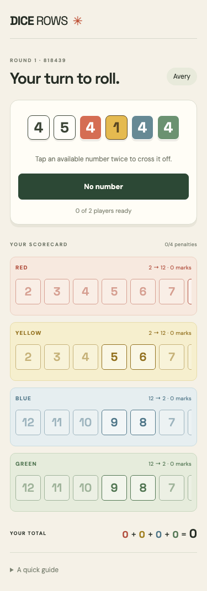

# Dice Rows

An original roll-and-cross web game for 2–5 friends on their phones. Host a room, share its six-digit code, and play together through the final score.

Shared client/server rules keep legal marks consistent, while the server advances turns only after every player finishes.



## Play locally

Requires Node.js 22.15+ and npm. There is no hosted deployment.

```sh
npm ci
npm run dev
```

Open **http://localhost:3000**. On phones connected to the same network, use the computer's LAN IP with port 3000. Every player needs their own browser tab. The host enters a name and shares the code; with at least two players in the lobby, the host starts.

For a production build served by the same Node process:

```sh
npm run build
npm start
```

`PORT` changes the default port. No environment variables or external services are required.

## How a turn works

- The active player rolls two white dice and one die for each open color.
- Everyone may cross the white total in one row. The active player may also combine one white die with a colored die in that color's row. Taking the color combination first gives up the white total.
- Cross numbers moving right; skipped numbers stay unavailable. Tap a legal number to highlight it, then tap it again to cross it. Tap elsewhere to cancel the highlight.
- The last number needs five previous crosses. It crosses the lock too. Locks become global after everyone finishes the roll, so several players can close the same row together.
- Choose **No number** when taking no marks, or confirm after marking. An empty active turn costs five points. Other players receive no penalty.
- Two closed rows or any player's fourth penalty ends the game once everyone finishes. Each row scores the sum from 1 through its number of marks, including its lock.

## Implementation and checks

React renders the phone-first interface. Express owns the in-memory games and validates every action using the same pure TypeScript rules that determine legal buttons in the client. A random session token binds actions to a player; the client cannot choose another player's identity. Clients poll the server for shared state.

Two choices keep the rules consistent: immutable transitions reject invalid actions without modifying boards, and row closure waits until every player's decisions are finished. This preserves simultaneous last-number marks while keeping turn advancement authoritative. See [the rules](src/shared/rules.ts) and [server tests](src/server/game.test.ts).

```sh
npm run lint
npm test
npm run build
npx playwright install chromium
npm run test:e2e
```

Unit and component tests cover marking, scores, locks, penalties, and rejected actions. Playwright exercises separate players at 375×812. GitHub Actions runs these checks. [Phone screenshots](docs/screenshots) show the lobby, both ends of the score card, and the final screen.

Kayla supplied the objective and checkable acceptance criteria through the define-work skill. Codex implemented this version against that brief with shared-rules, UI, and browser-check subtasks. A README review and automated checks support review; Kayla retains the merge decision.

## Limits

Games live in one server process and disappear when it restarts. Refreshing or disconnecting does not restore a seat; a missing player blocks play. There are no accounts, saved games, rematches, spectators, or deployment setup. Use a trusted local network: this version has no internet-facing abuse controls or persistent storage.
