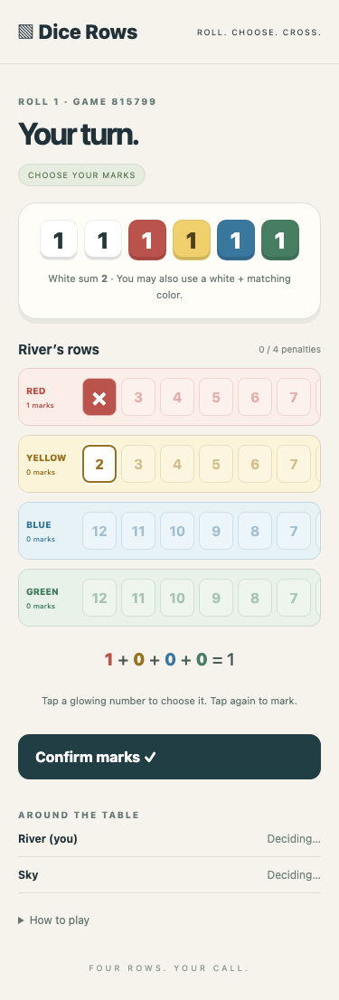

# Dice Rows

Dice Rows is a multiplayer roll-and-cross game for 1–6 people sharing a table, each with their own phone. Host a game, share its six-digit code, and choose numbers together as the dice travel around the table.



The server validates every move. Row locks resolve after the whole table finishes a roll, allowing multiple players to claim the same final number.

## Play locally

Requires Node.js 22.15 or later and npm.

```sh
npm ci
npm run dev
```

Open `http://localhost:5173`. To play from phones on the same Wi-Fi, open the computer’s LAN address on port 5173. The development client proxies `/ws` to the Node server on port 3001. Allow those local connections through your firewall if needed.

Enter a name to host, or enter a name and code to join. The host starts with 1–6 players. Only the current roller can roll. Tap a legal number twice to mark it; tap elsewhere to cancel the selection. Confirm your marks, or pass, so the table can advance.

## Rules at the table

- Red and yellow ascend from 2 to 12; blue and green descend from 12 to 2. Marks always move right, leaving skipped numbers behind.
- Everyone may mark the white-dice sum in one row. The roller can also combine either white die with one matching colored die. To use both actions, use the white sum first.
- Five existing marks unlock the last number. Taking it adds a lock mark too. Global locks apply after everyone finishes that roll, so multiple people can claim the same last number.
- Passing without a mark costs the roller five points. Other players can pass without penalty.
- Two globally locked rows or a player’s fourth penalty ends the game after the roll resolves. Row scores are triangular numbers, including lock marks. Tied leaders share the win.

Confirmed individual marks are final. Choosing a color combination first forfeits the unused white-sum action. The final confirmation ends your decisions for that roll.

## How it works

The Vite TypeScript client sends intentions over WebSockets. The Node server creates dice using `node:crypto`, identifies seats by opaque resume tokens, validates moves through the [pure rules module](src/rules.ts), and broadcasts the resulting state. Clients cannot supply their own dice or change another player’s card.

Same-roll locking is handled in two stages: final-number marks enter a pending lock list, then become global when every player finishes. [Rules tests](tests/rules.test.ts) cover that boundary, action order, penalties, locked dice, scoring and both game endings.

Games and seats live only in server memory. Refreshing restores a seat using localStorage; clearing browser storage loses that access. Disconnected seats remain at the table and block roll resolution until they return. Restarting the server loses all games. There are no accounts, database, hosted services or public deployment. This first version is intended for local play; it has no rate limiting or game expiry.

## Checks

```sh
npm test
npm run lint
npm run build
npx playwright install chromium
npm run test:browser
```

`lint` checks TypeScript and Prettier formatting. `build` type-checks and produces `dist/`. `npm start` starts the WebSocket server alone; production static hosting and deployment are not configured.

The [browser walkthrough](tests/browser/game.spec.ts) uses two isolated browser contexts, including a 375px phone viewport. A test-only injected dice source makes the full lock-and-end sequence reproducible; the normal server always uses random dice. The walkthrough saves real [lobby](docs/screenshots/lobby-after.png), [turn](docs/screenshots/turn-after.png) and [results](docs/screenshots/end-after.png) screenshots. The corresponding `before` images show the lobby before a second player joins, a turn before marking, and the last roll before confirmation; no application existed before this version.

## Development

Built with Codex from a human-specified game brief and acceptance criteria. Automated rules, WebSocket and browser checks provide review evidence. Changes are delivered for human review in a draft pull request; merging remains a human decision.
